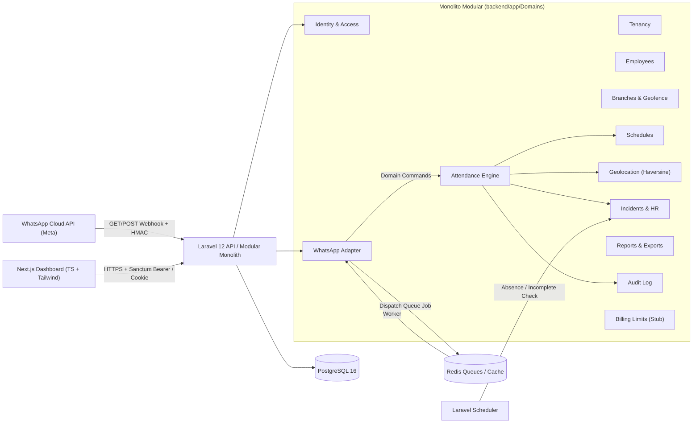

# CheckIn WA — Arquitectura del Sistema

> **Estado:** Fase 0 — Auditoría y Diseño Inicial  
> **Fecha:** 2026-11-25  
> **Estilo arquitectónico:** Monolito Modular (Laravel 12) + Frontend SPA/SSR (Next.js App Router) + Docker Compose

---

## 1. Visión General

**CheckIn WA** es una plataforma SaaS multi-tenant para el control de asistencia laboral mediante WhatsApp. Los empleados registran entradas, descansos y salidas enviando mensajes y ubicación puntual por WhatsApp, mientras que RRHH y gerentes operan un panel administrativo web en Next.js para gestionar sucursales, geocercas, horarios, incidencias y reportes.

### Principios rectores
1. **Sin microservicios en el MVP:** Un monolito modular en Laravel 12 dividido por dominios de negocio reduce latencia operativa, simplifica transacciones ACID entre módulos y acelera el despliegue.
2. **Canal desacoplado del dominio:** WhatsApp es un **adaptador de transporte**. El motor de asistencia (`Attendance`) y geolocalización (`Geolocation`) desconocen los detalles de Meta Cloud API y operan mediante comandos internos independientes del canal.
3. **Aislamiento multi-tenant estricto:** Base de datos PostgreSQL compartida con `tenant_id` obligatorio en toda entidad propiedad de empresa, políticas de autorización, scopes explícitos, índices compuestos y defensa en profundidad mediante Row-Level Security (RLS) cuando aplique.
4. **Docker-first para desarrollo y paridad:** Todo el stack corre en contenedores reproducibles (`nginx`/API PHP-FPM, queue worker, scheduler, PostgreSQL, Redis, Next.js) evitando inconsistencias con el host macOS.

---

## 2. Arquitectura Lógica y Monolito Modular



### Módulos de dominio (`backend/app/Domains/`)

| Dominio | Responsabilidad principal | Dependencias permitidas |
|---|---|---|
| **Tenancy** | Resolución de tenant activo, contexto transaccional, estado/plan del tenant | Ninguna (núcleo transversal) |
| **Identity** | Usuarios del dashboard, membresías `tenant_user`, roles RBAC, Sanctum, Policies | Tenancy |
| **Employees** | Alta/baja/edición de empleados, códigos únicos por tenant, asignaciones | Tenancy, Identity |
| **Branches** | Sucursales, coordenadas, radio de geocerca (metros), timezone IANA | Tenancy |
| **Schedules** | Turnos por día ISO, tolerancias, descansos permitidos, turnos nocturnos, vigencias | Tenancy, Employees |
| **Geolocation** | Cálculo de distancia Haversine, validación de rango `[-90,90]`/`[-180,180]`, selección de sucursal elegible más cercana | Branches |
| **Attendance** | Máquina de estados (`no_shift_open -> working -> on_break -> working -> closed`), eventos append-only, locks pesimistas (`FOR UPDATE`), `pending_actions` | Tenancy, Employees, Branches, Schedules, Geolocation, Audit |
| **Incidents** | Detección de retardos, faltas, salidas anticipadas, jornadas incompletas, exceso de descanso; flujo `pending/approved/rejected` y justificaciones | Tenancy, Attendance, Schedules, Audit |
| **WhatsApp** | Webhooks GET/POST, validación `X-Hub-Signature-256`, routing híbrido (central/dedicado), OTP de vinculación, idempotencia `wamid`, cliente Graph API | Tenancy, Employees, Attendance, Audit |
| **Reports** | Agregaciones diarias/mensuales, exportación CSV/XLSX/PDF | Attendance, Incidents, Employees, Branches |
| **Audit** | Registro inmutable de acciones administrativas, correcciones y cambios sensibles | Tenancy, Identity |
| **Billing** | Límites base por plan (ej. máx. empleados/sucursales/canales) sin pasarela de pago en MVP | Tenancy |

---

## 3. Estrategia de Multi-Tenancy y Seguridad

### Modelo de datos compartido con aislamiento lógico y físico
- **Entidades globales (sin `tenant_id` directo):** `users`, `whatsapp_contacts`, `personal_access_tokens`, `failed_jobs`.
- **Entidades de plataforma/mixtas:** `whatsapp_channels` (`tenant_id` `NULL` si `central`, `NOT NULL` si `dedicated`).
- **Entidades tenant-owned (`tenant_id NOT NULL`):** `tenant_user`, `employees`, `employee_whatsapp_contacts`, `branches`, `employee_branch_assignments`, `schedules`, `shift_assignments`, `attendance_records`, `attendance_events`, `breaks`, `pending_actions`, `incidents`, `justifications`, `audit_logs`.

### Reglas de aislamiento
1. **Nunca confiar en `tenant_id` del cliente HTTP ni de texto WhatsApp.** En el dashboard, el tenant se resuelve desde el usuario autenticado + cabecera/ruta validada contra `tenant_user` activa. En WhatsApp, se resuelve desde `whatsapp_channels` (dedicado) o desde `employee_whatsapp_contacts` verificada (central).
2. **Scoped Context (`TenantContext`):** Servicio singleton por request/job que mantiene el `tenant_id` activo y lo inyecta en Global Scopes de Eloquent y en variables de sesión PostgreSQL (`SET LOCAL app.current_tenant_id = ...`) dentro de transacciones cuando RLS esté habilitado.
3. **Integridad referencial intra-tenant:** Foreign keys compuestas `(tenant_id, entity_id)` en relaciones críticas (`attendance_records`, `employee_branch_assignments`, `shift_assignments`, `breaks`, `incidents`) para impedir referencias cruzadas entre empresas incluso ante errores de aplicación.
4. **Roles RBAC:**
   - `platform_admin`: operación global de plataforma, monitoreo de canales centrales, soporte.
   - `company_owner`: control total de su empresa, canales dedicados, usuarios y configuración.
   - `hr_admin`: gestión de empleados, horarios, incidencias, correcciones auditadas y reportes.
   - `branch_manager`: supervisión operativa y aprobación limitada a sus sucursales asignadas.
   - `employee`: acceso mínimo (auto-consulta o acciones propias si aplica portal web futuro).

---

## 4. Tiempo, Concurrencia y Geolocalización

### Manejo de tiempo y zonas horarias
- **Persistencia:** Todos los `timestamp` en PostgreSQL se almacenan en **UTC** (`timestamp with time zone`).
- **Autoridad del reloj:** Se usa exclusivamente el reloj del servidor al momento de recepción/procesamiento; nunca la hora local reportada por el dispositivo.
- **Evaluación de horarios:** Cada sucursal (`branches.timezone`) y horario (`schedules.timezone`) guarda su zona IANA (ej. `America/Mexico_City`). La conversión UTC <-> local se ejecuta al evaluar retardos, turnos nocturnos (ej. 22:00 a 06:00 del día siguiente) y transiciones de horario de verano (DST).

### Concurrencia e idempotencia
- **Webhooks:** Deduplicación temprana mediante índice único en `whatsapp_messages(whatsapp_channel_id, wamid)` (o `wamid` único global de Meta).
- **Asistencia:** Toda transición de turno abre transacción DB con `SELECT ... FOR UPDATE` sobre el registro activo de asistencia del empleado (`attendance_records`) o un lock distribuido/de fila en el empleado para evitar doble `clock_in` por clics o mensajes simultáneos.

### Geolocalización puntual (GPS)
- El empleado comparte su ubicación actual voluntariamente ante una solicitud (`pending_action`).
- Se valida `latitude ∈ [-90, 90]` y `longitude ∈ [-180, 180]`.
- El servicio `HaversineDistanceCalculator` calcula la distancia en metros contra las sucursales autorizadas y activas del empleado.
- Si existen múltiples sucursales elegibles, se evalúa la más cercana dentro de radio (o la más cercana para registrar distancia de rechazo).
- Cada evento guarda un **snapshot** (`branch_id`, `latitude`, `longitude`, `distance_meters`, `geofence_radius_meters`, `geofence_passed`) para que futuros cambios de coordenadas o radio en la sucursal no alteren la auditoría histórica.
- **Limitación asumida:** Meta Cloud API entrega coordenadas puntuales sin garantía criptográfica anti-spoofing ni campo de precisión garantizado; no existe seguimiento continuo en segundo plano.

---

## 5. Arquitectura Docker e Infraestructura

### Entorno de desarrollo (Docker Compose)
Dado que el host macOS auditado (`x86_64`) no cuenta con PostgreSQL instalado localmente ni extensión `phpredis` en el PHP del sistema, el proyecto estandariza su ejecución con **Docker Compose** (compatible con Docker Desktop y Colima):

| Servicio | Imagen / Base | Puerto local | Propósito |
|---|---|---|---|
| `nginx` | `nginx:1.27-alpine` | `8080` | Reverse proxy HTTP hacia PHP-FPM |
| `api` | PHP 8.4-FPM Alpine (`pdo_pgsql`, `redis`, `pcntl`, `bcmath`, `intl`) | `9000` (interno) | Aplicación Laravel 12 API |
| `worker` | Misma imagen `api` | - | `php artisan queue:work redis` |
| `scheduler` | Misma imagen `api` | - | `php artisan schedule:work` |
| `postgres` | `postgres:16-alpine` | `5432` | Base de datos principal multi-tenant |
| `redis` | `redis:7-alpine` | `6379` | Colas, caché, rate limiting y locks |
| `frontend` | Node 22/23 Alpine | `3000` | Dashboard Next.js (App Router + TS + Tailwind) |

### Arquitectura objetivo en AWS (Fase 6)
- **Compute:** ECS Fargate (servicios separados para API HTTP, Queue Workers y Scheduler cron/task).
- **Ingress:** Application Load Balancer (HTTPS/TLS 1.3 con ACM) + WAF en endpoints públicos/webhooks.
- **Datos:** Amazon RDS PostgreSQL (Multi-AZ, snapshots automáticos, cifrado KMS) + Amazon ElastiCache Redis.
- **Almacenamiento y secretos:** Amazon S3 (exportaciones temporales privadas con URLs firmadas) + AWS Secrets Manager (`APP_KEY`, `WHATSAPP_APP_SECRET`, claves de cifrado).
- **Observabilidad:** CloudWatch Logs (con redacción de PII y tokens), métricas de cola y alertas de errores 5xx / dead-letter queues.

---

## 6. Estructura de Carpetas Propuesta (Monorepo)

```text
checkin-wa/
├── .github/
│   └── workflows/               # CI: tests Pest, PHPStan/Pint, ESLint, Next build
├── backend/                     # Laravel 12 (PHP 8.3+/8.4)
│   ├── app/
│   │   ├── Domains/
│   │   │   ├── Attendance/
│   │   │   ├── Audit/
│   │   │   ├── Billing/
│   │   │   ├── Branches/
│   │   │   ├── Employees/
│   │   │   ├── Geolocation/
│   │   │   ├── Identity/
│   │   │   ├── Incidents/
│   │   │   ├── Reports/
│   │   │   ├── Schedules/
│   │   │   ├── Tenancy/
│   │   │   └── WhatsApp/
│   │   ├── Http/
│   │   │   ├── Controllers/Api/V1/
│   │   │   ├── Controllers/Webhooks/
│   │   │   ├── Middleware/
│   │   │   ├── Requests/
│   │   │   └── Resources/
│   │   └── Support/
│   ├── config/
│   ├── database/
│   │   ├── factories/
│   │   ├── migrations/
│   │   └── seeders/
│   ├── routes/
│   │   ├── api.php
│   │   └── web.php
│   └── tests/
│       ├── Feature/
│       ├── Unit/
│       └── Fixtures/WhatsApp/
├── frontend/                    # Next.js App Router + TypeScript + Tailwind CSS
│   ├── src/
│   │   ├── app/
│   │   ├── components/
│   │   ├── features/
│   │   ├── lib/
│   │   └── types/
│   └── tests/
├── infra/
│   ├── docker/
│   │   ├── nginx/
│   │   ├── php/
│   │   └── node/
│   └── aws/                     # Plantillas/notas de despliegue ECS/RDS/ElastiCache
├── docs/
│   ├── adr/                     # Architecture Decision Records
│   ├── ARCHITECTURE.md
│   ├── DATA_MODEL.md
│   ├── WHATSAPP_INTEGRATION.md
│   ├── IMPLEMENTATION_PLAN.md
│   └── LOCAL_DEVELOPMENT_MACOS.md
├── docker-compose.yml
├── .env.example
└── .gitignore
```
