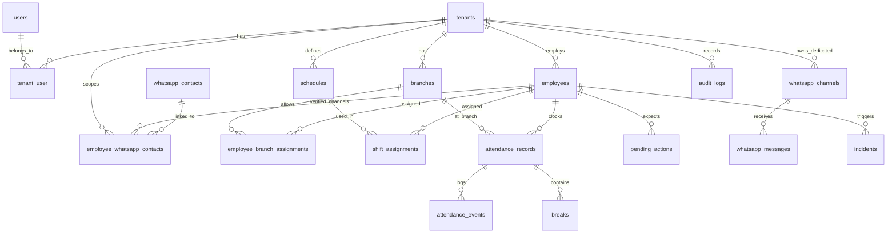

# CheckIn WA — Modelo de Datos

> **Motor objetivo:** PostgreSQL 16  
> **Estrategia:** Base de datos compartida, `tenant_id` obligatorio en entidades de empresa, timestamps en UTC (`timestamptz`), FKs compuestas para prevenir cruces entre tenants.

---

## 1. Diagrama Entidad-Relación (Core)



---

## 2. Catálogo de Tablas y Restricciones

### 2.1 Identidad, Plataforma y Tenancy

#### `tenants`
- `id` (bigint PK / UUID — recomendado `bigserial` o `uuid` consistente en todo el esquema; se recomienda `bigserial` por rendimiento de índices compuestos en PostgreSQL o `ulid`/`uuid` si se requiere opacidad externa; en API usar `public_id` UUID/ULID o UUID PK).
  - **Decisión inicial:** `id` (`bigserial` PK) + `public_id` (`uuid` único) o `uuid` PK nativo de PostgreSQL (`gen_random_uuid()`). Se adoptará **`bigserial` PK interno + `uuid` único público** (o `uuid` PK si Laravel 12 `HasUuids`). Para simplicidad e integridad en FKs compuestas, `bigserial` + `uuid` público en rutas API evita enumeración y optimiza B-Trees.
- `name` (`varchar(150)`, NOT NULL)
- `code` (`varchar(32)`, NOT NULL, UNIQUE) — Código legible usado en onboarding de canal central (ej. `ACME01`).
- `timezone` (`varchar(64)`, NOT NULL, default `'America/Mexico_City'`) — Zona IANA por defecto.
- `status` (`varchar(20)`, NOT NULL: `active`, `suspended`, `trial`)
- `plan_limits` (`jsonb`, nullable) — Límites base para futuro módulo Billing (`max_employees`, `max_branches`, `max_dedicated_channels`).
- `created_at`, `updated_at`, `deleted_at` (`timestamptz`)

#### `users` (global, usuarios del panel web)
- `id` (`bigserial` PK)
- `name` (`varchar(150)`, NOT NULL)
- `email` (`varchar(255)`, NOT NULL, UNIQUE)
- `password` (`varchar(255)`, NOT NULL)
- `is_platform_admin` (`boolean`, NOT NULL, default `false`)
- `email_verified_at` (`timestamptz`, nullable)
- `remember_token` (`varchar(100)`, nullable)
- `created_at`, `updated_at` (`timestamptz`)

#### `tenant_user` (membresías y roles por empresa)
- `id` (`bigserial` PK)
- `tenant_id` (`bigint`, NOT NULL, FK -> `tenants.id`)
- `user_id` (`bigint`, NOT NULL, FK -> `users.id`)
- `role` (`varchar(32)`, NOT NULL: `company_owner`, `hr_admin`, `branch_manager`, `employee`)
- `status` (`varchar(20)`, NOT NULL: `active`, `invited`, `suspended`)
- `branch_scope_ids` (`jsonb`, nullable) — Para restringir `branch_manager` a sucursales específicas.
- `created_at`, `updated_at` (`timestamptz`)
- **Restricciones:** `UNIQUE (tenant_id, user_id)`

---

### 2.2 WhatsApp Híbrido e Identidad de Empleados

#### `whatsapp_channels`
- `id` (`bigserial` PK)
- `tenant_id` (`bigint`, NULLABLE, FK -> `tenants.id`)
- `channel_type` (`varchar(20)`, NOT NULL: `central`, `dedicated`)
- `phone_number_id` (`varchar(64)`, NOT NULL, UNIQUE) — Identificador de Meta (`metadata.phone_number_id`).
- `business_account_id` (`varchar(64)`, NOT NULL) — WABA ID.
- `display_phone_number` (`varchar(32)`, NOT NULL)
- `access_token_encrypted` (`text`, NOT NULL) — Cifrado en reposo con `Crypt` de Laravel (`APP_KEY` / KMS).
- `verify_token_hash` (`varchar(255)`, nullable) — Hash si cada canal tiene token propio, o verificación central.
- `status` (`varchar(20)`, NOT NULL: `active`, `inactive`, `pending_verification`)
- `created_at`, `updated_at` (`timestamptz`)
- **Restricción CHECK:**
  - `(channel_type = 'central' AND tenant_id IS NULL) OR (channel_type = 'dedicated' AND tenant_id IS NOT NULL)`

#### `whatsapp_contacts` (directorio global de teléfonos)
- `id` (`bigserial` PK)
- `phone_e164` (`varchar(20)`, NOT NULL, UNIQUE) — Formato E.164 normalizado (ej. `+5215512345678`).
- `wa_id` (`varchar(32)`, nullable) — Identificador crudo recibido de Meta si difiere del E.164 normalizado.
- `profile_name` (`varchar(150)`, nullable)
- `created_at`, `updated_at` (`timestamptz`)

#### `employee_whatsapp_contacts` (vínculo multi-empresa)
- `id` (`bigserial` PK)
- `tenant_id` (`bigint`, NOT NULL)
- `employee_id` (`bigint`, NOT NULL)
- `whatsapp_contact_id` (`bigint`, NOT NULL, FK -> `whatsapp_contacts.id`)
- `is_primary` (`boolean`, NOT NULL, default `true`)
- `verified_at` (`timestamptz`, nullable)
- `linked_via_channel_id` (`bigint`, nullable, FK -> `whatsapp_channels.id`)
- `created_at`, `updated_at` (`timestamptz`)
- **Restricciones:**
  - FK compuesta `(tenant_id, employee_id)` -> `employees(tenant_id, id)`
  - `UNIQUE (tenant_id, employee_id, whatsapp_contact_id)`
  - `UNIQUE (tenant_id, whatsapp_contact_id)` — Un número de teléfono corresponde como máximo a un empleado dentro de la misma empresa, aunque el mismo contacto global pueda vincularse a varias empresas distintas.

#### `whatsapp_link_otps` (códigos de un solo uso para onboarding)
- `id` (`bigserial` PK)
- `tenant_id` (`bigint`, NOT NULL)
- `employee_id` (`bigint`, NOT NULL)
- `whatsapp_contact_id` (`bigint`, NOT NULL, FK -> `whatsapp_contacts.id`)
- `whatsapp_channel_id` (`bigint`, NOT NULL, FK -> `whatsapp_channels.id`)
- `code_hash` (`varchar(255)`, NOT NULL) — Hash HMAC/Argon/SHA256 del OTP.
- `attempts` (`smallint`, NOT NULL, default `0`)
- `max_attempts` (`smallint`, NOT NULL, default `5`)
- `expires_at` (`timestamptz`, NOT NULL)
- `consumed_at` (`timestamptz`, nullable)
- `created_at`, `updated_at` (`timestamptz`)

---

### 2.3 Organización, Sucursales y Horarios

#### `branches`
- `id` (`bigserial` PK)
- `tenant_id` (`bigint`, NOT NULL, FK -> `tenants.id`)
- `code` (`varchar(32)`, NOT NULL)
- `name` (`varchar(150)`, NOT NULL)
- `address` (`varchar(255)`, nullable)
- `latitude` (`decimal(10,7)`, NOT NULL) — Validado `[-90, 90]`
- `longitude` (`decimal(10,7)`, NOT NULL) — Validado `[-180, 180]`
- `geofence_radius_meters` (`integer`, NOT NULL, default `100`) — Validado `>= 10`
- `timezone` (`varchar(64)`, NOT NULL) — IANA timezone
- `status` (`varchar(20)`, NOT NULL: `active`, `inactive`)
- `created_at`, `updated_at`, `deleted_at` (`timestamptz`)
- **Restricciones:**
  - `UNIQUE (tenant_id, id)` (para FKs compuestas)
  - `UNIQUE (tenant_id, code)`

#### `employees`
- `id` (`bigserial` PK)
- `tenant_id` (`bigint`, NOT NULL, FK -> `tenants.id`)
- `employee_code` (`varchar(32)`, NOT NULL)
- `first_name` (`varchar(100)`, NOT NULL)
- `last_name` (`varchar(100)`, NOT NULL)
- `email` (`varchar(255)`, nullable)
- `default_branch_id` (`bigint`, nullable)
- `status` (`varchar(20)`, NOT NULL: `active`, `inactive`, `suspended`)
- `hired_at` (`date`, nullable)
- `created_at`, `updated_at`, `deleted_at` (`timestamptz`)
- **Restricciones:**
  - `UNIQUE (tenant_id, id)` (para FKs compuestas)
  - `UNIQUE (tenant_id, employee_code)`
  - FK compuesta `(tenant_id, default_branch_id)` -> `branches(tenant_id, id)`

#### `employee_branch_assignments`
- `id` (`bigserial` PK)
- `tenant_id` (`bigint`, NOT NULL)
- `employee_id` (`bigint`, NOT NULL)
- `branch_id` (`bigint`, NOT NULL)
- `effective_from` (`date`, NOT NULL)
- `effective_until` (`date`, nullable)
- `created_at`, `updated_at` (`timestamptz`)
- **Restricciones:**
  - FK compuesta `(tenant_id, employee_id)` -> `employees(tenant_id, id)`
  - FK compuesta `(tenant_id, branch_id)` -> `branches(tenant_id, id)`

#### `schedules`
- `id` (`bigserial` PK)
- `tenant_id` (`bigint`, NOT NULL, FK -> `tenants.id`)
- `name` (`varchar(120)`, NOT NULL)
- `timezone` (`varchar(64)`, NOT NULL)
- `work_days` (`jsonb`, NOT NULL) — Array de días ISO-8601 (`1` = Lunes ... `7` = Domingo) o detalle por día.
- `start_time` (`time`, NOT NULL) — Hora local de entrada
- `end_time` (`time`, NOT NULL) — Hora local de salida (si `end_time <= start_time`, es turno nocturno que cruza medianoche)
- `late_tolerance_minutes` (`smallint`, NOT NULL, default `10`)
- `absence_threshold_minutes` (`smallint`, NOT NULL, default `120`)
- `break_duration_minutes` (`smallint`, NOT NULL, default `30`)
- `max_breaks_per_shift` (`smallint`, NOT NULL, default `2`)
- `status` (`varchar(20)`, NOT NULL: `active`, `inactive`)
- `created_at`, `updated_at`, `deleted_at` (`timestamptz`)
- **Restricciones:** `UNIQUE (tenant_id, id)`

#### `shift_assignments`
- `id` (`bigserial` PK)
- `tenant_id` (`bigint`, NOT NULL)
- `employee_id` (`bigint`, NOT NULL)
- `schedule_id` (`bigint`, NOT NULL)
- `effective_from` (`date`, NOT NULL)
- `effective_until` (`date`, nullable)
- `created_at`, `updated_at` (`timestamptz`)
- **Restricciones:**
  - FK compuesta `(tenant_id, employee_id)` -> `employees(tenant_id, id)`
  - FK compuesta `(tenant_id, schedule_id)` -> `schedules(tenant_id, id)`

---

### 2.4 Asistencia, Máquina de Estados y Geolocalización

#### Máquina de estados de `attendance_records`
```text
no_shift_open  --(clock_in)-->  working  --(break_start)-->  on_break
                                  ^                             |
                                  |---------(break_end)---------|
                                  |
                             (clock_out) --> closed
```
- **Reglas inviolables:**
  - No puede haber más de un `attendance_records` en estado `working` o `on_break` por `(tenant_id, employee_id)`. Se recomienda índice único parcial PostgreSQL:
    `CREATE UNIQUE INDEX attendance_one_open_shift_per_employee ON attendance_records (tenant_id, employee_id) WHERE status IN ('working', 'on_break');`
  - Prohibido doble `clock_in`.
  - Prohibido `clock_out` sin sesión abierta o mientras `status = 'on_break'`.
  - Prohibido `break_start` si ya está en `on_break` (sin descansos anidados).
  - Prohibido `break_end` si no está en `on_break`.

#### `attendance_records`
- `id` (`bigserial` PK)
- `tenant_id` (`bigint`, NOT NULL)
- `employee_id` (`bigint`, NOT NULL)
- `branch_id` (`bigint`, nullable) — Sucursal donde inició turno
- `schedule_id` (`bigint`, nullable) — Snapshot del horario vigente al abrir turno
- `work_date` (`date`, NOT NULL) — Fecha operativa local del turno
- `status` (`varchar(20)`, NOT NULL: `working`, `on_break`, `closed`)
- `clock_in_at` (`timestamptz`, NOT NULL)
- `clock_out_at` (`timestamptz`, nullable)
- `total_worked_minutes` (`integer`, nullable)
- `total_break_minutes` (`integer`, NOT NULL, default `0`)
- `late_minutes` (`integer`, NOT NULL, default `0`)
- `early_departure_minutes` (`integer`, NOT NULL, default `0`)
- `created_at`, `updated_at` (`timestamptz`)
- **Restricciones:**
  - `UNIQUE (tenant_id, id)`
  - FK compuesta `(tenant_id, employee_id)` -> `employees(tenant_id, id)`
  - Índice único parcial para turno abierto único por empleado.

#### `attendance_events` (historial inmutable append-only)
- `id` (`bigserial` PK)
- `tenant_id` (`bigint`, NOT NULL)
- `attendance_record_id` (`bigint`, nullable) — Puede ser nullable en intentos rechazados fuera de geocerca
- `employee_id` (`bigint`, NOT NULL)
- `branch_id` (`bigint`, nullable)
- `event_type` (`varchar(30)`, NOT NULL: `clock_in`, `break_start`, `break_end`, `clock_out`, `correction`, `rejected_geofence`)
- `source` (`varchar(30)`, NOT NULL: `whatsapp_central`, `whatsapp_dedicated`, `admin_correction`, `system`)
- `whatsapp_channel_id` (`bigint`, nullable, FK -> `whatsapp_channels.id`)
- `wamid` (`varchar(128)`, nullable)
- `received_at` (`timestamptz`, NOT NULL)
- `event_at` (`timestamptz`, NOT NULL)
- `latitude` (`decimal(10,7)`, nullable)
- `longitude` (`decimal(10,7)`, nullable)
- `distance_meters` (`decimal(10,2)`, nullable)
- `geofence_radius_meters` (`integer`, nullable) — Snapshot del radio evaluado
- `geofence_passed` (`boolean`, nullable)
- `notes` (`text`, nullable)
- `metadata` (`jsonb`, nullable)
- `created_at` (`timestamptz`, NOT NULL) — Sin `updated_at` para reforzar semántica append-only.

#### `breaks`
- `id` (`bigserial` PK)
- `tenant_id` (`bigint`, NOT NULL)
- `attendance_record_id` (`bigint`, NOT NULL)
- `started_at` (`timestamptz`, NOT NULL)
- `ended_at` (`timestamptz`, nullable)
- `duration_minutes` (`integer`, nullable)
- `created_at`, `updated_at` (`timestamptz`)
- **Restricciones:**
  - FK compuesta `(tenant_id, attendance_record_id)` -> `attendance_records(tenant_id, id)`

#### `pending_actions` (solicitudes activas de ubicación o selección)
- `id` (`bigserial` PK)
- `tenant_id` (`bigint`, nullable) — Nullable si es selección de empresa en canal central
- `employee_id` (`bigint`, nullable)
- `whatsapp_channel_id` (`bigint`, NOT NULL, FK -> `whatsapp_channels.id`)
- `whatsapp_contact_id` (`bigint`, NOT NULL, FK -> `whatsapp_contacts.id`)
- `action_type` (`varchar(40)`, NOT NULL: `awaiting_location_clock_in`, `awaiting_location_clock_out`, `awaiting_tenant_selection`, `awaiting_otp`)
- `context` (`jsonb`, nullable)
- `expires_at` (`timestamptz`, NOT NULL) — Por defecto +2 minutos para ubicación
- `consumed_at` (`timestamptz`, nullable)
- `created_at`, `updated_at` (`timestamptz`)

---

### 2.5 Incidencias, Justificaciones, Mensajería y Auditoría

#### `incidents`
- `id` (`bigserial` PK)
- `tenant_id` (`bigint`, NOT NULL)
- `employee_id` (`bigint`, NOT NULL)
- `attendance_record_id` (`bigint`, nullable)
- `branch_id` (`bigint`, nullable)
- `incident_date` (`date`, NOT NULL)
- `type` (`varchar(30)`, NOT NULL: `late`, `absence`, `early_departure`, `incomplete_shift`, `excess_break`, `outside_geofence`)
- `status` (`varchar(20)`, NOT NULL: `pending`, `approved`, `rejected`)
- `minutes_affected` (`integer`, nullable)
- `justification_note` (`text`, nullable)
- `reviewed_by_user_id` (`bigint`, nullable, FK -> `users.id`)
- `reviewed_at` (`timestamptz`, nullable)
- `created_at`, `updated_at` (`timestamptz`)

#### `whatsapp_messages` (log redactado e idempotencia)
- `id` (`bigserial` PK)
- `whatsapp_channel_id` (`bigint`, NOT NULL, FK -> `whatsapp_channels.id`)
- `tenant_id` (`bigint`, nullable, FK -> `tenants.id`) — Nullable hasta resolver ruta
- `whatsapp_contact_id` (`bigint`, nullable, FK -> `whatsapp_contacts.id`)
- `direction` (`varchar(10)`, NOT NULL: `inbound`, `outbound`)
- `wamid` (`varchar(128)`, nullable, UNIQUE)
- `message_type` (`varchar(30)`, NOT NULL: `text`, `interactive`, `location`, `template`, `status`)
- `delivery_status` (`varchar(20)`, nullable: `received`, `queued`, `processed`, `sent`, `delivered`, `read`, `failed`)
- `payload_redacted` (`jsonb`, NOT NULL) — Payload sin tokens ni datos sensibles innecesarios
- `received_at` (`timestamptz`, NOT NULL)
- `processed_at` (`timestamptz`, nullable)
- `error_message` (`text`, nullable)
- `created_at`, `updated_at` (`timestamptz`)

#### `audit_logs`
- `id` (`bigserial` PK)
- `tenant_id` (`bigint`, nullable, FK -> `tenants.id`)
- `actor_user_id` (`bigint`, nullable, FK -> `users.id`)
- `actor_type` (`varchar(30)`, NOT NULL: `user`, `system`, `employee_whatsapp`)
- `action` (`varchar(80)`, NOT NULL) — Ej. `attendance.corrected`, `incident.approved`, `branch.geofence_updated`
- `auditable_type` (`varchar(120)`, NOT NULL)
- `auditable_id` (`bigint`, NOT NULL)
- `old_values` (`jsonb`, nullable)
- `new_values` (`jsonb`, nullable)
- `ip_address` (`varchar(45)`, nullable)
- `user_agent` (`varchar(255)`, nullable)
- `created_at` (`timestamptz`, NOT NULL)
